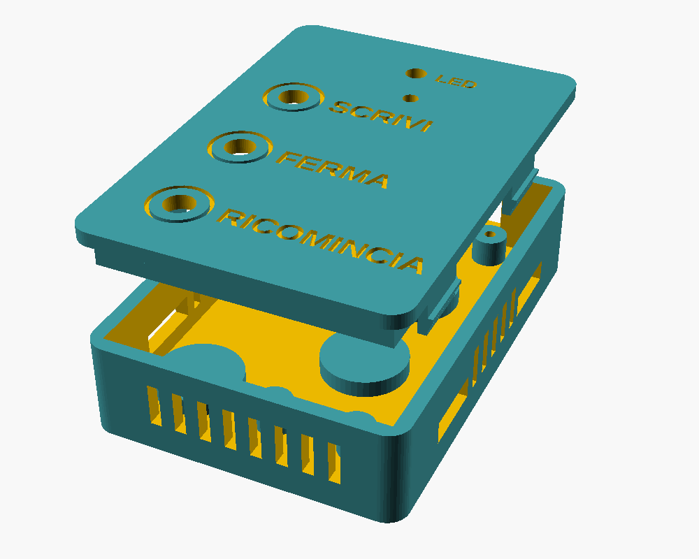

# Case per la chiavetta

Case stampabile in 3D per il Pico 2 W e i tre tasti **Scrivi**, **Ferma** e **Ricomincia**. È in due pezzi che si chiudono con due ganci e due viti M3, con calamite sotto.

Il progetto è in [docs/2026-11-15-case-chiavetta.md](../docs/2026-11-15-case-chiavetta.md), il collegamento dei tasti in [docs/2026-11-14-tastiera-3-tasti.md](../docs/2026-11-14-tastiera-3-tasti.md).

| File | Cosa contiene |
|---|---|
| `case-chiavetta.scad` | il disegno, con tutte le misure in cima come parametri |
| `case-fondo.stl` | il fondo, pronto da stampare |
| `case-coperchio.stl` | il coperchio, già capovolto per la stampa |
| `anteprima.png` | i due pezzi, con il coperchio sollevato |



Misure: circa 34 × 62 × 16 mm, più i pulsanti che sporgono di circa 2,5 mm.

Sul coperchio ogni tasto ha il suo simbolo inciso, grande 10 mm: **▶ Scrivi**, **⏸ Ferma**, **↻ Ricomincia**.

## Cosa serve

- Pico 2 W **senza pin** saldati;
- 3 pulsantini tattili **6 × 6 mm, alti 8 mm** (pulsante Ø 3,5 mm);
- 2 calamite al neodimio **Ø 10 × 3 mm**;
- 2 o 4 viti autofilettanti **M2 × 5**, per il Pico;
- 2 **inserti filettati in ottone M3**, lunghi fino a 4 mm, per un foro da Ø 4 mm (se i tuoi vogliono un altro foro, vedi *Adattare le misure*);
- 2 viti **M3 × 6 o M3 × 8 a testa svasata** (DIN 7991 / ISO 10642), per il coperchio;
- filo sottile, colla istantanea, colla a caldo, saldatore.

## Stampa

- Senza supporti:
  - il fondo dritto;
  - il coperchio capovolto, con i simboli sul piatto, come negli STL.
- **PETG** consigliato: regge caldo e olio. Va bene anche il PLA.
- Strato 0,2 mm, riempimento 20 %, 3 perimetri.
- Le sedi delle calamite sono sotto il fondo: il loro tetto si stampa a ponte. Se esce un po' cadente non importa.

## Montaggio

0. **Inserti filettati:** vanno nelle due colonnine sul lato sinistro del fondo e si mettono a caldo, con il saldatore:
   - saldatore a **220–240 °C** per il PETG, 200–220 °C per il PLA, con una punta conica pulita;
   - si appoggia l'inserto sul foro, dritto, con il lato più largo in alto;
   - si appoggia la punta dentro il filetto dell'inserto e lo si lascia scendere **senza spingere forte**: la plastica si scioglie intorno e lui entra da solo in 5–10 secondi;
   - ci si ferma quando è a filo con la colonnina, si toglie il saldatore e si preme subito sopra qualcosa di piatto e freddo (il lato di una chiave, una piastrina) per qualche secondo, così resta dritto e a filo;
   - se è entrato storto, si riscalda e si raddrizza finché la plastica è ancora morbida;
   - è meglio farlo prima di montare il Pico, così il calore non lo raggiunge.
1. **Calamite:**
   - una goccia di colla istantanea in ognuna delle due sedi sotto il fondo, poi si spinge dentro la calamita;
   - mettile **tutte e due con lo stesso polo verso l'esterno**: così non si respingono tra loro sulla macchina.
2. **Pulsantini:**
   - dall'interno del coperchio, si spinge ognuno tra le sue due linguette, con il pulsante nel foro;
   - **le zampine vanno verso i lati senza linguette**, cioè verso le viti;
   - le linguette tengono solo il centro e la parte alta del pulsantino, così le zampine si possono piegare **di lato** (verso il Pico o verso la parete) senza toccarle. Non piegarle verso le viti: lì toccherebbero le colonnine;
   - un punto di colla a caldo sul retro lo tiene fermo.
3. **Fili:**
   - si collega **un piedino di ogni pulsantino al comune**, cioè un filo che va al pin **18 (GND)** del Pico;
   - l'altro piedino va al suo pin:

   | Tasto | Pin del Pico |
   |---|---|
   | ▶ Scrivi (in alto) | 20 (GP15) |
   | ⏸ Ferma (al centro) | 19 (GP14) |
   | ↻ Ricomincia (in basso) | 17 (GP13) |

   - In un pulsantino 6 × 6 i due piedini dello stesso lato sono separati, quelli uno di fronte all'altro sono uniti: usa **due piedini in diagonale** e vai sul sicuro.
   - Lascia i fili lunghi circa 6 cm, così il coperchio si apre senza strapparli.
4. **Pico:** si appoggia sulle colonnine con la presa USB verso l'apertura e si fissa con le viti M2. Non stringere troppo: la scheda non deve piegarsi.
5. **Chiusura:**
   - il coperchio va tenuto con i fori delle viti a sinistra, sopra le colonnine, e il simbolo ▶ dalla parte della presa USB;
   - si infila inclinato, prima il lato destro (quello del Pico), così i due ganci entrano nelle loro sedi, scavate in alto sul lato interno della parete;
   - poi si abbassa il lato sinistro e si avvitano le due viti svasate, senza forzare: basta che la testa sia a filo.

**Per riaprire:** si tolgono le due viti, si solleva il lato sinistro e si sfila il coperchio verso sinistra. Gli inserti di ottone reggono tutte le aperture che servono.

## Cosa c'è sul coperchio

- **Tubetto LED:** si vede la luce del LED del Pico, compresi i tre lampi di Ricomincia.
- **Forellino accanto:** è sopra il tasto BOOTSEL del Pico. Serve solo in caso di emergenza per ricaricare il firmware: si collega il cavo tenendolo premuto con una graffetta.

## Adattare le misure

In cima a `case-chiavetta.scad` ci sono tutti i parametri:

- tolleranza;
- spessori;
- misure dei pulsantini;
- posizione dei tasti;
- calamite;
- ganci, viti e inserti.

Se i pezzi entrano troppo stretti, alza `tolleranza` (es. 0,3).

Se i tuoi inserti vogliono un foro diverso da 4 mm, o sono più lunghi di 4 mm, cambia `inserto_foro` e `inserto_l` con le misure del venditore. La colonnina deve avere almeno 1,6 mm di plastica intorno al foro: se il foro supera 4 mm, alza anche `colonna_d`.

Per rifare gli STL serve [OpenSCAD](https://openscad.org): scegli `parte` (`"fondo"` o `"coperchio"`), premi F6, poi *File → Export → STL*. Da riga di comando:

```
openscad -o case-fondo.stl -D "parte=\"fondo\"" case-chiavetta.scad
openscad -o case-coperchio.stl -D "parte=\"coperchio\"" case-chiavetta.scad
```

**Dopo aver cambiato le misure, fai il controllo.** Con `parte = "ingombri"` si vedono in verde il Pico, la presa USB, la spina e i pulsantini dentro il case. Con `parte = "controllo"` si vede solo dove toccano il case. Deve restare solo il contatto piatto del Pico sulle colonnine, nient'altro.

Il file è stato provato con OpenSCAD 2021.01.
